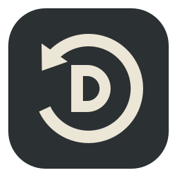
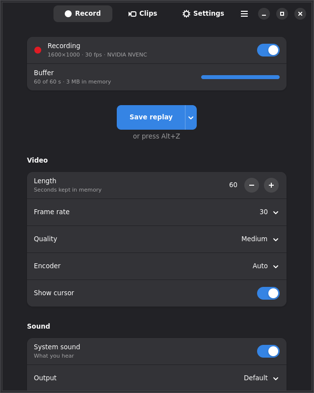
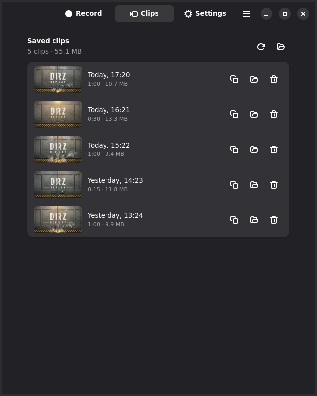
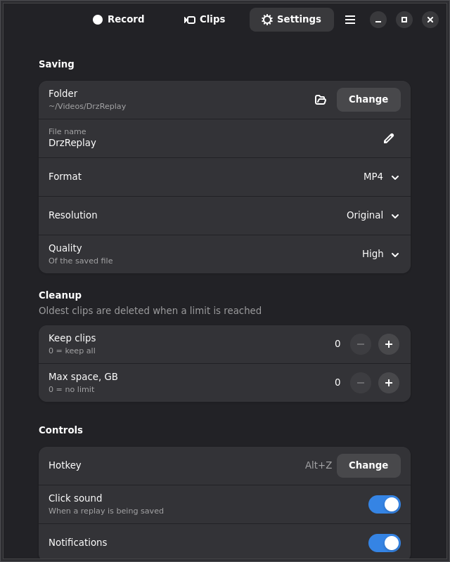
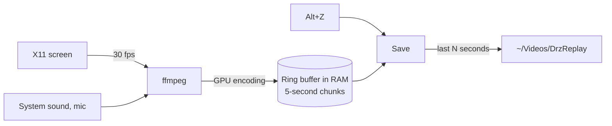

<div align="center">



# DrzReplay

**Instant replay for Linux.** Your screen is always recorded into memory —
press **Alt+Z** and the last minute becomes a video file.

[](https://github.com/upidddd/drzreplay/releases/latest)
[](https://github.com/upidddd/drzreplay/releases)
[](#requirements)
[](LICENSE)

```sh
curl -fsSL https://github.com/upidddd/drzreplay/releases/latest/download/install.sh | sh
```

  

</div>

## Why

Something great happened in a game, a call or on stream — and you weren't recording.
DrzReplay is always recording, but only in memory, so nothing piles up on your disk.
When you want to keep the moment, one key saves it.

## Features

- **Always on, never in the way.** Video is compressed by the graphics card (NVIDIA NVENC or
  AMD/Intel VA-API), so the recorder takes about 3 % of the CPU and games keep their FPS.
  The last minute lives in RAM (10–100 MB), the disk is only touched when you save.
- **One key.** Alt+Z (or any key you pick) works everywhere, including fullscreen games that
  grab the keyboard. Press it twice and you get two clips — nothing is lost.
- **Shorter clips.** Save just the last 15 or 30 seconds from the tray or the Record tab.
- **Sound.** System sound and your microphone, each with its own device and volume.
- **Clips tab.** Thumbnails, length and size of every clip. Click to play, **drag a clip
  straight into Discord or Telegram**, copy it, show it in the folder or move it to the trash.
- **Clean up by itself.** Keep only the last N clips or at most N GB.
- **Updates.** The app tells you when a new version is out; one click starts the installer.
- **Works on** XFCE, KDE, Cinnamon, MATE, GNOME on Xorg and tiling window managers like **i3**.


## Install

```sh
curl -fsSL https://github.com/upidddd/drzreplay/releases/latest/download/install.sh | sh
```

It downloads the latest release, asks for your password and installs it. DrzReplay opens and
starts recording right away; from then on it starts with your computer.

- **Update:** run the same command again, or press *Update* in the app.
  Settings and clips are kept; the running recorder switches to the new version by itself.
- **Manual install:** download `drzreplay_*_all.deb` from
  [Releases](https://github.com/upidddd/drzreplay/releases) and run
  `sudo apt install ./drzreplay_*_all.deb`.
- **Uninstall:** `sudo apt remove drzreplay`

### Requirements

- Debian 13, Devuan 6, Ubuntu 24.04 or newer (and distros based on them: Mint, Pop!_OS…)
- An **X11 (Xorg)** session. Wayland is not supported — pick an "Xorg" session on the login screen.
- Any graphics card. Without NVENC / VA-API the CPU encoder (x264) is used.

## Using it

| | |
|---|---|
| **Alt+Z** | save the last minute (length is set on the Record tab) |
| **Tray icon** | right click: save, save last 15 / 30 s, pause, folder, settings |
| **Middle click on the tray icon** | save |
| **Menu → DrzReplay** | the window with the Record, Clips and Settings tabs |

Clips go to `~/Videos/DrzReplay` as `DrzReplay 2026-11-02 17-20-10.mp4`.

## How it works



1. A background recorder (`drzreplay daemon`) runs ffmpeg, which grabs the screen and sound and
   writes 5-second chunks to `/dev/shm` (RAM). The oldest chunk is overwritten, so memory use stays flat.
2. A tiny helper listens for the hotkey through X11 raw input events — that is why it keeps working
   while a fullscreen game holds the keyboard.
3. On save, the chunks are copied, glued together and trimmed to exactly the last N seconds,
   and the result is encoded on the GPU with low priority.

## Troubleshooting

<details>
<summary><b>The hotkey does nothing</b></summary>

- Settings → Controls shows *Not working* next to the hotkey when another program owns it.
  Pick a different key there.
- Every press is logged in `/dev/shm/drzreplay-$(id -u)/hotkey.log`. If presses show up there
  but no clip appears, check the recorder log (window menu → *Recorder log*).
</details>

<details>
<summary><b>No sound in clips</b></summary>

Record tab → Sound: make sure *System sound* is on and *Output* is the device you listen to.
If capturing sound fails three times, the recorder continues without sound and says so in a
notification and on the Record tab.
</details>

<details>
<summary><b>"Screen capture needs an Xorg session"</b></summary>

You are on Wayland. Log out, pick the *Xorg* / *X11* variant of your desktop on the login screen,
and log in again.
</details>

<details>
<summary><b>i3: no tray icon, no notifications, no autostart</b></summary>

- **Tray:** with `tray_output primary` in your bar config the monitor must be primary
  (`xrandr --output <name> --primary`), or use `tray_output <name>`.
- **Notifications** need a notification daemon: add `exec --no-startup-id dunst` to your i3 config
  (the package installs dunst if you have none).
- **Autostart:** if your config doesn't run `dex --autostart`, the *Start with computer* switch
  adds one marked line (`exec --no-startup-id drzreplay daemon  # DrzReplay autostart`) and removes
  it again when switched off.
- The window opens floating. Make sure Alt+Z isn't bound in your i3 config.
</details>

<details>
<summary><b>The game stutters while recording</b></summary>

Check that the encoder on the Record tab says *NVIDIA NVENC* or *VA-API*. With *CPU (x264)*,
lower the frame rate to 30 and the quality to *Low* or *Medium*.
</details>

## Command line

```
drzreplay                      open the window
drzreplay save [--seconds N]   save a replay now (optionally only the last N seconds)
drzreplay start|stop|restart   control the background recorder
drzreplay status               what the recorder is doing
```

## Building

```sh
packaging/build-deb.sh     # -> dist/drzreplay_<version>_all.deb
packaging/release.sh       # build + publish a GitHub release (needs gh)
```

Run from source without installing: `PYTHONPATH=src python3 -m drzreplay`.
It needs `python3-gi gir1.2-gtk-4.0 gir1.2-adw-1 ffmpeg x11-xserver-utils pulseaudio-utils`.

## Credits

Sounds from OpenGameArt.org: "Sci-Fi Pack Vol 1" by JC Sounds (CC BY 4.0),
"Mechanical Sounds" by Brian MacIntosh (CC0) and "Iron Door" (CC0).
Font: Oswald (SIL OFL). Details in [`src/assets/CREDITS.txt`](src/assets/CREDITS.txt).

Code: [MIT](LICENSE).
